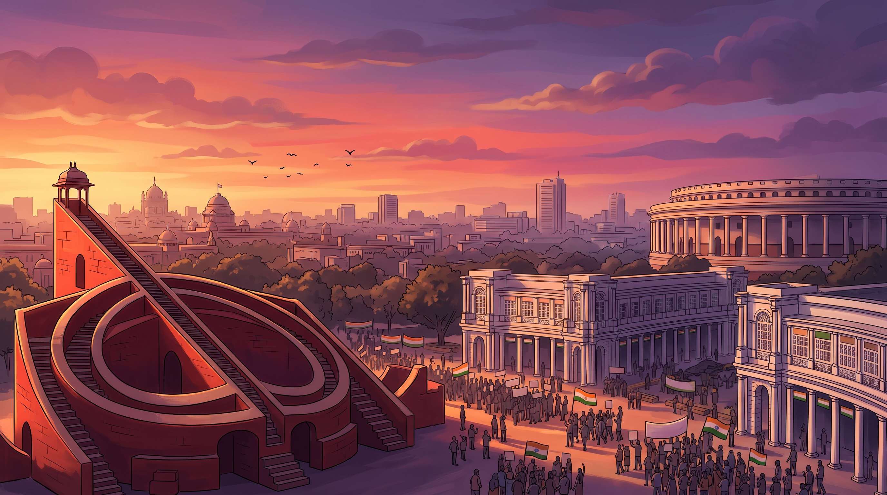
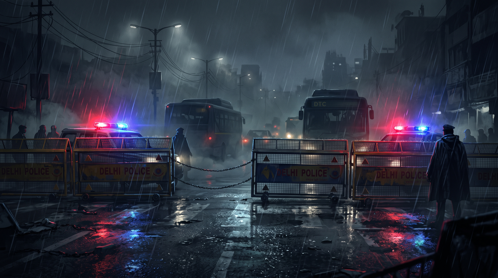
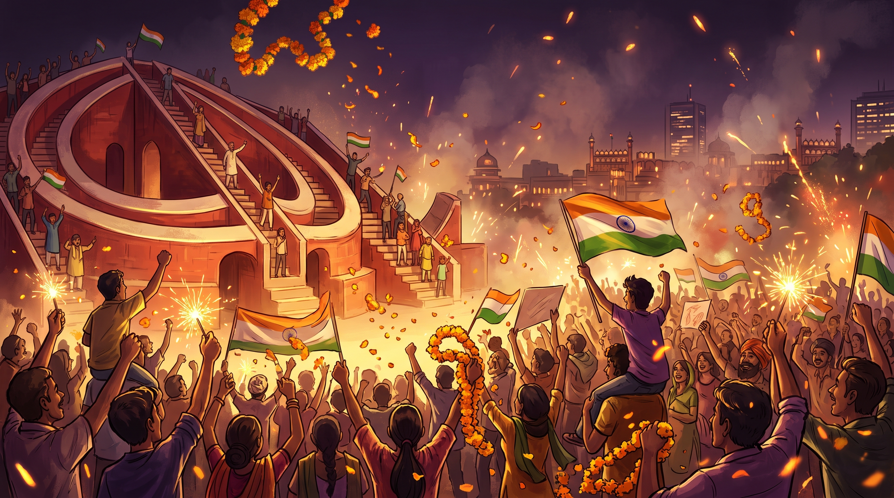

<div align="center">

# 🏛️ Chalo Jantar Mantar (चलो जंतर मंतर)
### *A Satirical 2.5D Isometric Delhi Protest March Simulator*

[](https://www.typescriptlang.org/)
[](https://phaser.io/)
[](https://vitejs.dev/)
[](https://developer.mozilla.org/)
[](CONTRIBUTING.md)
[](LICENSE)

<br/>



<p align="center">
  <b>Lead the Kafila • Dodge Section 144 Crackdowns • Chant Slogans • Reach the Historic Samrat Yantra</b>
</p>

[Play Demo](#-quick-start) • [Game Features](#-key-features) • [Controls](#-controls) • [Levels](#-level-design--hardness-rating) • [Architecture](#-software-architecture) • [Contribute](#-contributing--open-source)

</div>

---

## 📖 Satirical Delhi Lore & Game Overview

Inspired by Delhi's iconic marches that navigate the historic radial boulevards from ITO and Mandi House up to Connaught Place and Parliament Street, **Chalo Jantar Mantar** is a high-octane 2.5D isometric crowd simulation game.

You step into the boots of the **Protest Leader (*आंदोलनकारी*)**:
- 🚩 **Gather Your Kafila**: Rally neutral citizens and bystanders into an unstoppable march.
- 📢 **Chant Slogans**: Raise morale with slogans (*"Chalo Jantar Mantar!"*, *"Azaadi!"*, *"Hum Honge Kaamyab!"*) to expand your crowd aura and push back solitary constables.
- 🚧 **Smash Through Barricades**: Delhi Police yellow steel barricades block key intersections. Gather crowd mass and activate sprint dashes to break through.
- 🚨 **Section 144 Detention Hazards**: Avoid police encirclement! If your detention meter fills to 100%, you get **DETAINED** and diverted to the Talkatora Stadium holding camp!
- ⚖️ **Anticipatory Bail (*वकील साहब*)**: Collect community ₹ Chanda funds to summon a bail lawyer, clearing your detention meter instantly.
- 🚜 **Tractor Rally Power-Up**: Mount the mighty Swaraj green tractor to crush obstacles and become invincible.
- 🏛️ **Destination Jantar Mantar**: Overcome tear gas smoke, Vajra water cannons, and GPS internet jammers to establish your dharna at the terracotta **Samrat Yantra** monument!

---

## 📸 In-Game Visuals & Cinematic Art

| The March Towards Parliament | Police Section 144 Crackdown | Victory at Samrat Yantra |
|:---:|:---:|:---:|
|  |  |  |
| *Crowds gathering across Delhi boulevards* | *Rainy night barricades, flashing sirens & Section 144* | *Tricolor confetti & fireworks at Jantar Mantar* |

---

## ⚡ Key Features

- **🎮 Dual-Platform Input Support**: Seamlessly engineered for **PC (Desktop/Laptop keyboard)** and **Mobile (iOS & Android touch screen)** with custom dual-virtual joystick & quick-action buttons.
- **👥 Flocking & Crowd AI (Swarm Dynamics)**: Crowd members follow boids-inspired physics algorithms (alignment, separation, cohesion), scattering when hit by tear gas or water cannon jets and regrouping when slogans are chanted.
- **🔊 100% Procedural Web Audio Synthesizer**: Zero external MP3/WAV download latency! A built-in synthesizer dynamically generates Indian dholak beats, police sirens, crowd roars, megaphone chants, lathi clashes, and victory fanfares via the Web Audio API.
- **⚠️ Section 144 Detention Mechanic**: Realistic escalation system featuring police constables, lathi squads, riot shield units, and surveillance drones.
- **🚚 Authentic Delhi Vehicles & Props**:
  - DTC Low-Floor Green Buses (create street traffic gridlocks)
  - Delhi Auto-Rickshaws (weaving obstacles)
  - Police PCR Gypsies & Surveillance Drones with spotlight detection cones
  - *Vajra* Water-Cannon Riot Trucks with particle physics
  - Mobile Internet Jammer Vans (scrambles GPS radar in real time)
  - Community Langar & Cutting Chai Stalls (restore stamina and crowd count)

---

## 🕹️ Controls

### 💻 PC & Laptop (Desktop / Web)
| Action | Keybinding |
|---|---|
| **Movement** | `W`, `A`, `S`, `D` or `Arrow Keys` |
| **Slogan / Chant (नारेबाज़ी)** | `Spacebar` or `C` or `E` |
| **Sprint / Dash (दौड़)** | Hold `Shift` |
| **Anticipatory Bail (वकील)** | `B` (Requires ₹50 Chanda) |
| **Sound Mute / Unmute** | Audio icon (Top-Right HUD) |

### 📱 Mobile & Tablet (iOS Safari / Android Chrome / Capacitor App)
| Action | Mobile Touch Control |
|---|---|
| **Movement** | Floating Analog Virtual Joystick (bottom-left area) |
| **Chant Slogan** | Green `📢 CHANT` button (bottom-right) |
| **Sprint Charge** | Orange `⚡ DASH` button (bottom-right) |
| **Bail Button** | Blue `⚖️ BAIL` action button (bottom-right) |

---

## 🗺️ Level Design & Hardness Rating

```
  [Level 1: Low Hardness]          [Level 2: Mid Hardness]          [Level 3: Hard / Insane]
   ITO Chowk → Tilak Marg       Mandi House → Connaught Place     Parliament St → Jantar Mantar
  ━━━━━━━━━━━━━━━━━━━━━━━━━    ━━━━━━━━━━━━━━━━━━━━━━━━━━━━━    ━━━━━━━━━━━━━━━━━━━━━━━━━━━━━
  • Target: 8+ Citizens         • Target: 16+ Citizens           • Target: 28+ Citizens
  • Single barricades           • Double-tier barricades         • Triple-tier riot walls
  • Solitary constables         • Tear Gas & Jammer Vans         • Vajra Water Cannons & Drones
```

1. **Level 1: ITO Chowk to Tilak Marg (`LOW HARDNESS`)**
   - Ideal for learning crowd gathering, movement, and sprint charges.
   - Low police presence; single-layer yellow barricades; leisurely DTC bus traffic.

2. **Level 2: Mandi House to Connaught Place Circle (`MID HARDNESS`)**
   - High traffic density with auto-rickshaws and barricades.
   - Police deployment of Tear Gas canisters and Mobile Internet Jammer vans that scramble your radar under Section 144.

3. **Level 3: Parliament Street to Jantar Mantar (`TOUGH / HARD`)**
   - Massive 3-layer steel barricades and high-speed riot police.
   - High-pressure *Vajra* Water Cannon trucks pushing marchers backward, drone spotlights, and intense Section 144 crackdowns.
   - Victorious finale at the **Samrat Yantra** observatory stage!

---

## 🏗️ Software Architecture

The project is structured according to international software engineering standards: strict TypeScript typing, modular scene graph pipelines, procedural vector sprite generation, and entity-component logic.

```
country_defender/
├── public/
│   ├── assets/                 # High-resolution background art (menu, victory, detained)
│   ├── favicon.svg             # Vector game favicon
│   └── manifest.json           # PWA progressive web app manifest
├── screenshots/                # Showcase artwork & gameplay screenshots for GitHub
├── src/
│   ├── main.ts                 # App bootstrap, canvas mounting, font loading
│   ├── style.css               # Responsive full-bleed canvas, iOS safe-area handling
│   ├── config/
│   │   ├── constants.ts        # Isometric projection angles, game dimensions, physics constants
│   │   ├── gameConfig.ts       # Phaser ScaleManager, Multi-touch, Scene registrations
│   │   └── levelData.ts        # Level metadata, route distances, hazard spawn tables
│   ├── core/
│   │   ├── IsometricUtils.ts   # 2.5D Screen-to-Cartesian & Cartesian-to-Screen transforms
│   │   ├── SoundSystem.ts      # Web Audio procedural sound synthesizer (0 audio file latency)
│   │   ├── InputHandler.ts     # Unified Desktop (WASD) + Mobile Touch Virtual Joystick
│   │   └── SaveManager.ts      # Persistent local storage for high scores, names, progress
│   ├── entities/
│   │   ├── Player.ts           # Leader mechanics (sprint stamina, detention meter, flag physics)
│   │   ├── CrowdMember.ts      # Autonomous flocking crowd (follower states, chant reactions)
│   │   ├── PoliceOfficer.ts    # Finite state machine (Patrol, Whistle, Chase, Detain)
│   │   ├── Barricade.ts        # Physics-enabled yellow Delhi Police barricades with HP
│   │   ├── Vehicle.ts          # DTC Buses, Auto-Rickshaws, PCR Gypsies, Vajra, Jammer Vans
│   │   └── Hazards.ts          # Tear Gas volumetric smoke & Water Cannon fluid jets
│   └── scenes/
│       ├── BootScene.ts        # Procedural texture generator (vector graphics cached to textures)
│       ├── MenuScene.ts        # Title screen, high score records, guide modals
│       ├── LevelSelectScene.ts # Mission selection cards with hardness badges
│       ├── GameScene.ts        # Core loop: entity updating, collision resolution, camera tracking
│       ├── UIScene.ts          # HUD overlay: Minimap radar, crowd counter, detention status, controls
│       ├── VictoryScene.ts     # Samrat Yantra celebration, score breakdown, confetti
│       └── GameOverScene.ts    # Section 144 "DETAINED" debrief & Talkatora Stadium diversion lore
└── tsconfig.json               # Strict TypeScript configuration
```

---

## 🚀 Quick Start

### Prerequisites
- [Node.js](https://nodejs.org/) (version 18.0.0 or higher recommended)
- [npm](https://www.npmjs.com/) (version 9.0.0 or higher)

### Installation & Run

```bash
# 1. Clone the repository
git clone https://github.com/Shailendrawilliam/janter-mantar-game.git

# 2. Navigate to project directory
cd country_defender

# 3. Install dependencies
npm install

# 4. Start local development server
npm run dev
```

Open **`http://localhost:5173/`** in your browser to launch the game!

### Production Build & Type Checking

```bash
# Run strict TypeScript compiler verification & Vite bundle optimization
npm run build

# Preview production build locally
npm run preview
```

---

## 📱 Exporting to iOS & Android Native App

This codebase is pre-configured with responsive viewport metadata, iOS safe-area insets, and multi-touch gesture handlers ready for **Capacitor**:

```bash
# 1. Build web assets
npm run build

# 2. Install Capacitor
npm install @capacitor/core @capacitor/cli @capacitor/ios @capacitor/android

# 3. Initialize App
npx cap init "Chalo Jantar Mantar" "com.chalojantarmantar.game" --web-dir=dist

# 4. Add iOS & Android platforms
npx cap add ios
npx cap add android

# 5. Open Xcode or Android Studio
npx cap open ios
```

---

## 🌟 Code Quality & Engineering Highlights

- ✅ **Strict TypeScript 5.0+**: Zero implicit `any`, full type contracts for entities, scenes, and events.
- ✅ **Deterministic Isometric Depth Sorting**: Every frame dynamically sorts sprites based on Cartesian Y-coordinates to eliminate visual z-fighting.
- ✅ **Zero Asset Bloat**: Procedural generation in `BootScene` ensures instantaneous load times and zero network overhead on mobile connections.
- ✅ **Cross-Browser & Multi-Touch Compliant**: Fully responsive on Chrome, Safari, Firefox, Edge, and iOS WebViews with gesture locking (`touch-action: none`).

## 🗺️ Roadmap & Priority To-Do List (Contributions Wanted! 🚀)

Looking for exciting open-source challenges? Here are the top community features currently prioritized:

- [ ] **🌐 Real-Time Multiplayer Mode (Co-Op & PvP)**:
  - **Co-op Kafila March**: Team up with friends online via WebSockets / WebRTC / Colyseus. Merge crowds into a mega-rally to overwhelm heavy multi-tier riot cordons.
  - **Asymmetric PvP Mode (Protesters vs Delhi Police)**: One player directs police squad placements, water cannon deployments, and Section 144 blockades while other players navigate the march.
- [ ] **🎭 Role Selection & Character Archetypes (Characterization)**:
  - Add character selection with unique passive perks and abilities:
    - 🎓 *Student Union Leader*: High sprint speed, quick megaphone cooldown.
    - 🌾 *Kisan Union Chief*: Enhanced crowd inertia, tractor durability buff.
    - ⚖️ *Legal Aid Advocate*: 50% cheaper anticipatory bail, faster detention meter recovery.
    - 🥁 *Dholak & Cultural Artist*: Massive morale aura expansion and crowd stun radius.
- [ ] **📸 Custom Face Photo Upload (Avatar & Placard Integration)**:
  - In-game photo upload tool: Upload your face selfie directly from mobile/web.
  - Automatically cropped and rendered onto the in-game 2.5D leader sprite, march placards, and newspaper victory/detained headlines!
- [ ] **🏆 Online Global Leaderboard**:
  - Connect endless march high scores and Kafila sizes to a Supabase / Firebase backend.
- [ ] **🚊 Overhead Delhi Metro Hazard**:
  - Blue Line / Yellow Line trains passing overhead periodically with dynamic shadows and rumbling audio.

---

## 🤝 Contributing & Open Source

Contributions, issue reports, and feature suggestions are warmly welcomed! If you'd like to work on any of the roadmap items above:

1. **Fork** the project on GitHub.
2. Create your feature branch (`git checkout -b feature/MultiplayerOrRoleSelection`).
3. Commit your changes (`git commit -m 'feat: Add leader role selection screen'`).
4. Push to your branch (`git push origin feature/MultiplayerOrRoleSelection`).
5. Open a **Pull Request**.

If you enjoy the game or found the code helpful, please **give it a ⭐ Star**! It helps the project reach more contributors!

---

## 📜 Disclaimer & License

*Chalo Jantar Mantar is a satirical work of parody and entertainment celebrating citizen unity and public spirit in a light-hearted simulation game. All characters, vehicles, and scenarios are fictional or satirical representations.*

Distributed under the **MIT License**. See `LICENSE` for more details.

<div align="center">
  <sub>Made with ❤️ for Indian Indie Gaming & Open Source Community</sub>
</div>
